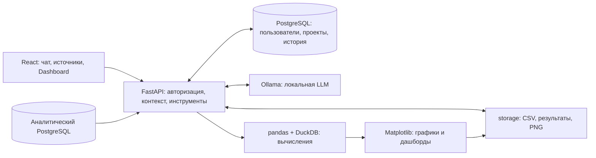

# Архитектура и стек

## Текущая архитектура

1. Пользователь загружает CSV или выбирает настроенную таблицу PostgreSQL.
2. Backend читает данные. Модель получает структуру и результаты инструментов, выбирает операцию и её параметры.
3. Параметры проверяются; код считает показатели по всем загруженным строкам. DuckDB выполняет только SELECT с ограничениями времени и памяти.
4. Приложение показывает рассчитанную таблицу и формулу, сохраняет результаты и изображения. История и источники доступны в следующих сообщениях чата.

## Стек

| Часть | Технологии |
|---|---|
| Интерфейс | React, Vite, Axios, Zustand, CSS, Markdown/KaTeX |
| API | Python, FastAPI, Uvicorn, Pydantic |
| Модель | Ollama; Qwen3.8-4B GGUF; OpenAI-совместимый локальный API |
| Подготовка контекста | Transformers — локальный токенизатор; история и её сокращение |
| Расчёты | pandas, DuckDB; специализированные бизнес-инструменты |
| Визуализации | Matplotlib, PNG; дашборды из 2–6 панелей |
| Хранение и доступ | PostgreSQL, SQLAlchemy, psycopg2; JWT/cookie, Argon2 |
| Запуск и проверки | Docker Compose, unittest; отдельные прогоны реальной модели |

В Compose три сервиса: frontend, backend и PostgreSQL. Ollama работает на компьютере пользователя.
Тома `pg-data` и `agent-data` сохраняют БД и файлы; каталог модели подключён только для чтения.
Запросы можно отменять; остановка привязана к конкретному request_id.

## Ограничения

- Один процесс backend: состояние занятых чатов и отмены находится в памяти.
- Данные обрабатываются в DataFrame; объём ограничен настройками и RAM.
- Дашборды — сохранённые PNG. Прогнозы и сценарные оценки базовые, причинность не устанавливается.
- На CPU ответ модели может занимать несколько минут.

## Опциональная целевая архитектура

Это план развития, не реализованные возможности:

- Отдельные вычислительные workers и очередь задач; общее состояние отмены и прогресса.
- Расчёты больших таблиц непосредственно в аналитической БД; уменьшение загрузки данных в RAM.
- Локальная модель на GPU и сокращение лишних обращений к ней.
- Интерактивные дашборды, миграции БД, резервное копирование и автоматические браузерные проверки.

Запуск: [README.md](README.md). Результаты по требованиям: [Сriteria.md](Сriteria.md).
